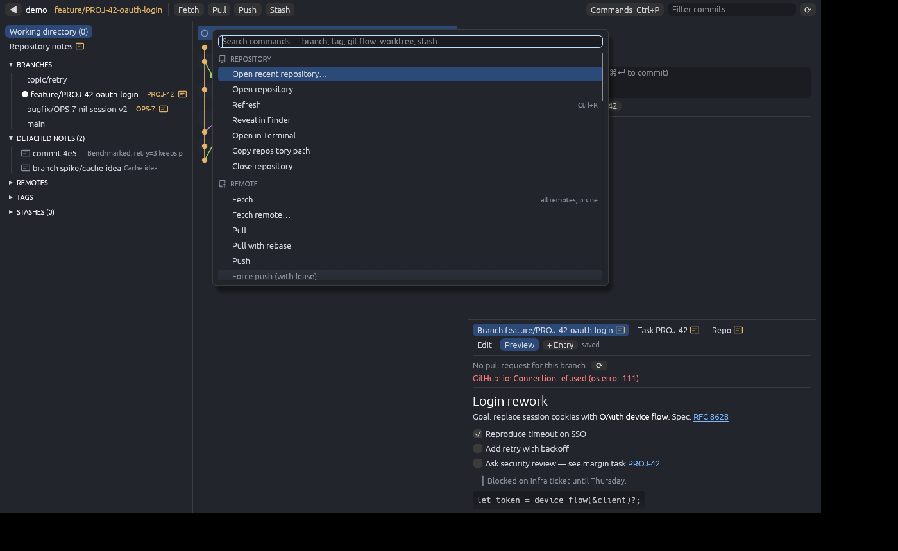

# Margin

A super-light git client (Rust + egui) for macOS. It adds **Markdown notes** on commits, branches, tasks, and the repo, **GitHub PR status**, and **task-tracker** links (Jira API; Linear, Asana and others via URL template). An **MCP server** lets AI agents read and write the same notes you do.




| | |
|---|---|
| GUI binary (release, stripped) | ~13.2 MB |
| MCP server binary | ~2.8 MB |
| Idle CPU | ~0 (repaints only on input or when a note changes) |
| Private memory, small repo | ~40 MB |

## What it does

**Command palette (⌘P)**: every action, fuzzy-searchable and grouped with icons. The groups are *In progress* (continue/abort), Repository, Remote, Commit, Branch, Tag, Stash, Worktree, Git Flow, Submodule, GitHub, Notes, and Go to. Commands that need input ask for it inside the palette: pick a branch, type a name, or confirm. ↑/↓ move, ↵ runs, and Esc steps back.

| Group | Commands |
|---|---|
| Remote | fetch (all or one remote), pull, pull with rebase, push, force push (with lease), add, rename, remove, or set-URL a remote, delete a remote branch |
| Commit | commit, amend, stage/unstage all, discard all, revert, cherry-pick, reset (soft/mixed/hard) |
| Branch | new, checkout (local or remote), merge, rebase onto, rename (note follows), delete, force delete, set upstream, push to remote, link task |
| Tag | create (lightweight or annotated), checkout, delete, push one or all, delete on remote |
| Stash | stash, stash with message, pop latest, apply, pop, drop |
| Worktree | open, add for an existing branch, add with a new branch (folder defaults to `../<repo>-<branch>`), remove, force remove, prune |
| Git Flow | initialize; Feature, Bugfix, Release, Hotfix, Support: start, finish (release and hotfix are tagged), publish |
| Other | submodule update/sync; continue/skip/abort a merge, rebase, cherry-pick, or revert; open or create a PR, open the repo on GitHub; open notes; go to a branch, tag, or commit |

**Git Flow without the extension.** It's implemented with plain git and uses the standard `gitflow.*` config, so it's compatible with repos set up by `git flow init`. Finish is idempotent: after a merge conflict, resolve it, commit, and run Finish again. A hotfix goes into an open release branch if there is one, like git-flow does.

**Toolbar** (the only bar, at the top):

```
[repo ▾] [branch ▾] [‹][›]        [Commands ⌘P] [Search commits…]        status · Undo  [Fetch][▾] [Pull ↓n] [Push ↑n]
```
- **Tab strip (design trial):** a row of tabs above the toolbar. The active tab blends into the toolbar, × shows on hover, middle-click closes, and **+** opens Change directory. Turn it off in Settings → Appearance or with ⌘P → *Toggle tab strip*. It lives in `tab_strip.rs`, so removing it is a one-commit revert.
- **repo ▾ (directory tabs)**: each opened repository or worktree is its own tab, and the name shows its position (`demo 1/3`). The dropdown lists open tabs (click to switch, × to close), then recent repositories, Open repository…, Reveal in Finder, Open in Terminal, and Close tab. ⌘P → **Change directory…** picks from open tabs, this repo's worktrees, and recent repos. Ctrl+Tab / Ctrl+Shift+Tab (or ⌘⇧] / ⌘⇧[) cycle tabs. Each tab keeps its own selection, history, notes editor, and PR status, and open tabs are restored on restart. A tab only loads when you first switch to it. Results of background work for a hidden tab never touch the visible one: the tab is refreshed when you come back to it.
- **branch ▾**: switch branch, New branch…, more branch commands. A merge or rebase in progress shows as a red badge (click it for continue/abort).
- **‹ ›**: back and forward through what you selected (commits, working directory), like a browser. ⌘[ / ⌘] or the mouse back/forward buttons also work. Commits that no longer exist (rebased away) are skipped.
- **[Fetch][▾]** fetches all remotes (with prune). **▾** opens a menu: Fetch now, Fetch a remote…, an auto-fetch toggle, **Fetch settings…**, and the last fetch time. The button reads *Fetch ⟳* while auto-fetch is on.
- **Auto-fetch** (Settings → Fetch): enable/disable and set the interval in minutes (1–1440; presets 5/15/30/60). It's off by default. It runs in the background without blocking your own git operations, and waits if one is running. It's quiet on success (the graph and PR status just update) and shows a message only on failure. There's no polling: the app wakes once when the next fetch is due. Settings are saved in `settings.json` next to `config.json`.
- **Status messages, errors, and Undo** appear just left of the Fetch/Pull/Push buttons. Stash and Refresh are in ⌘P; refresh also happens on window focus and ⌘R.

**Git (Sublime Merge–style)**
- Commit graph across all branches, remotes, and tags, virtualised for large histories, with a filter box.
- Working directory: stage or unstage files, **per-hunk** stage, unstage, and discard, and commit or amend (⌘↵).
- Commit details: message, parents, and a full diff (large diffs are virtualised and capped at 8 MB).
- Branches: checkout, create, delete, merge. Remotes: tracking checkout. Tags, stashes (apply, pop, drop).
- **Ahead/behind badges:** each branch with an upstream shows a right-aligned pill, `2↓ │ 1↑` (behind, then ahead, like Sublime Merge). A dimmed `gone` pill means the upstream was deleted on the remote. Hover for details. Counts are as of the last fetch, so auto-fetch keeps them current. Long names truncate before the task key, note, PR, and badge, so those stay visible.
- **Branch groups:** branches that share a prefix (`feature/`, `hotfix/`, `release/`, or any custom one like `projectA/`) are grouped once 2 or more share it. A prefix with a single branch stays flat (`projectA/login-page`). This applies at every level, and single-child chains are compacted (`projectB/feature/`). The top level is alphabetical; **inside a group, branches are most-recently-committed first**. Groups show a count and start open only if they contain the current or focused branch. Indentation is one shallow 12pt step per level, and the ● current-branch marker sits in the triangle column so names stay aligned. The same grouping applies under each remote and in the toolbar's branch switcher (as submenus).
- Commit menu: new branch here, detached checkout, cherry-pick, revert, reset (soft, mixed, hard).
- Fetch, pull, and push run in the background. The UI refreshes when the window regains focus.

**Notes**
- Notes attach to `repo`, `branch:<name>`, `commit:<sha>`, and `task:<KEY>`.
- **Two kinds of git notes:**
  - **Branch note:** bound to the branch name. It's shown on the branch's **top commit** (a chip in the graph, and the default tab when you select the tip). It follows the branch through rebase, amend, and new commits. Use it for ongoing work.
  - **Commit note:** bound to one exact SHA. After a rebase or amend it stays with the old commit. Use it for facts about that exact snapshot (benchmarks, review of that revision).
- **Branch renames are followed.** Renaming in Margin (right-click → Rename…) or in a terminal (`git branch -m`, read from the reflog, including chains) moves the branch note and task link to the new name.
- **Automatic re-attach (git patch-id).** When a commit note's commit is rewritten without changing its diff (rebase, cherry-pick, message-only amend), the note moves to the new commit automatically, and the toolbar message says so. It only moves on a unique match. If the change itself was edited (amend with new content, squash), the note stays detached for you to decide. Turn it off with `"auto_reattach": false`.
- **Undo for automatic re-attach.** Every automatic move can be reverted from the toolbar message ("Undo"), the sidebar's **Re-attached** list, or the banner on the note itself. Undo puts the note back on the old commit and restores the destination exactly, including a note that was there before a merge. If you edited the re-attached note afterwards, your edits are kept. An undone move is never applied automatically again. **Keep** confirms a move and clears it from the list.
- **Detached notes.** Commit notes whose commit is no longer on any branch, tag, or remote, and branch notes whose branch was deleted, are listed in the sidebar. Open one to see why it's detached. If the same change exists in several commits, each one is a one-click target. **Re-attach…** suggests the rewritten commit (patch-id match, else same subject), or you can delete it. Moving onto an existing note appends instead of overwriting.
- Markdown with tables, task lists, and links. **Images, raw HTML, and unsafe link schemes are rejected** on every write, from both the GUI and MCP.
- Edit and preview modes, autosave, and clickable task checkboxes. Internal links like `margin:commit:abc123` and `margin:task:PROJ-42` navigate inside the app.
- Concurrency-safe: versioned writes. If an agent edits the note you're editing, you get a *Load theirs / Keep mine* choice.

**GitHub pull requests** (github.com and Enterprise Server). Display-only, so everything links out to GitHub.
- Merge readiness: *Ready to merge*, *Changes requested*, *Review required*, *Merge conflicts*, *Behind base*, *Draft*, *Merged*…
- CI status with each check (failures first, click to open the run).
- Comments: conversation comments, reviews, and unresolved review threads (`file:line`), newest first.
- Shown as a `#123` chip on the branch tip and in the sidebar, plus a PR card on the branch tab. One GraphQL request covers all local branches. It reloads on window focus (at most once a minute) and after fetch, pull, or push.

**Tasks (Jira Cloud and Data Center)**
- The task key is inferred from the branch name (`feature/PROJ-42-login` → `PROJ-42`), or you can link it explicitly.
- The task card shows status, assignee, priority, and description. "My tasks" can create a branch from a ticket. The commit box offers an "Insert PROJ-42" button.

**MCP (for agents)**: 18 tools. `get_context`, `git_status`, `git_log`, `git_show`, and `list_branches` read git. `read_note`, `write_note`, `append_note`, `list_notes`, `search_notes`, and `link_task` work on notes. `get_task`, `search_tasks`, and `my_tasks` read Jira. `get_pr` gives agents the PR's readiness, failing checks, and review comments, so they can address feedback. `list_detached_notes`, `move_note`, and `undo_reattach` let agents tidy notes after a rebase. Git access is **read-only** for agents.

## Build

Requires Rust 1.88+ and `git` on `PATH`.

```bash
cargo build --release
```

```bash
./target/release/margin /path/to/repo
```

## Connect an agent

```bash
claude mcp add margin -- /path/to/margin/target/release/margin-mcp --repo /path/to/repo
```

Any MCP client works the same way (stdio transport): command `margin-mcp`, args `["--repo", "<path>"]`.
Agent notes are signed with the client's name, or with `MARGIN_AGENT_NAME` if set.

## Configure Jira

Copy `docs/config.example.json` to `~/Library/Application Support/Margin/config.json`.

- **Jira Cloud:** set `"flavor": "cloud"` and your `email`. The token is an Atlassian API token.
- **Jira Data Center/Server:** set `"flavor": "data_center"`. The token is a Personal Access Token.

The token is never stored in the config file. It's read from `$MARGIN_JIRA_TOKEN`, or from the macOS Keychain:

```bash
security add-generic-password -s margin-jira -a you@your-company.com -w
```

TLS uses the OS trust store, so corporate CAs installed in the Keychain work. `HTTPS_PROXY` and `NO_PROXY` are honoured.

## Configure GitHub

Nothing is needed if you use the GitHub CLI: Margin reuses `gh auth token`. Otherwise set `GITHUB_TOKEN`, or add the token to the Keychain:

```bash
security add-generic-password -s margin-github -a github.com -w
```

For GitHub Enterprise Server, list your host in `github.enterprise_hosts`. If you use SSH host aliases from `~/.ssh/config` (`git@github-work:org/repo`), map them in `github.host_aliases`.

## Link other task trackers

Without a Jira API config, set `task_url_template` (for example `https://linear.app/acme/issue/{key}`). Task keys found in branch names then open in that tracker with one click.

## Where notes live

`<repo>/.git/margin/notes/`. Notes are plain `.md` files, never committed, and shared across worktrees. They're easy to grep, back up, or sync.

See [docs/ARCHITECTURE.md](docs/ARCHITECTURE.md) for design decisions and the roadmap. Icons: [Primer Octicons](https://github.com/primer/octicons) (MIT), see [THIRD_PARTY_NOTICES.md](THIRD_PARTY_NOTICES.md).
