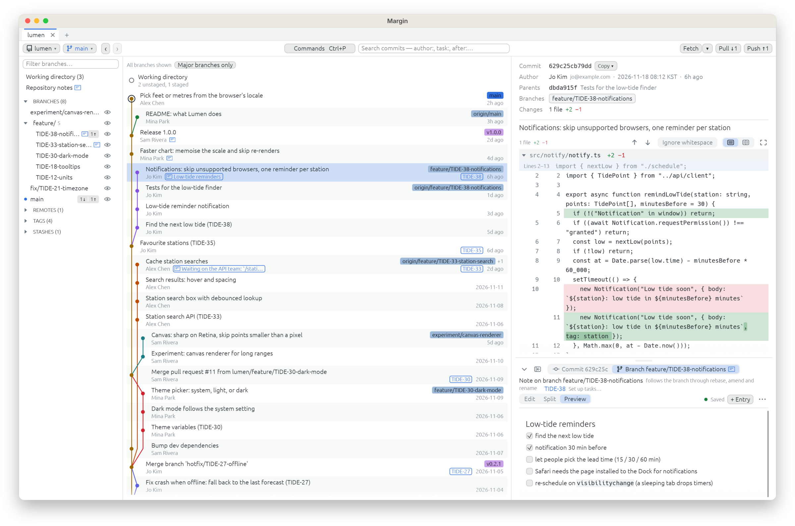
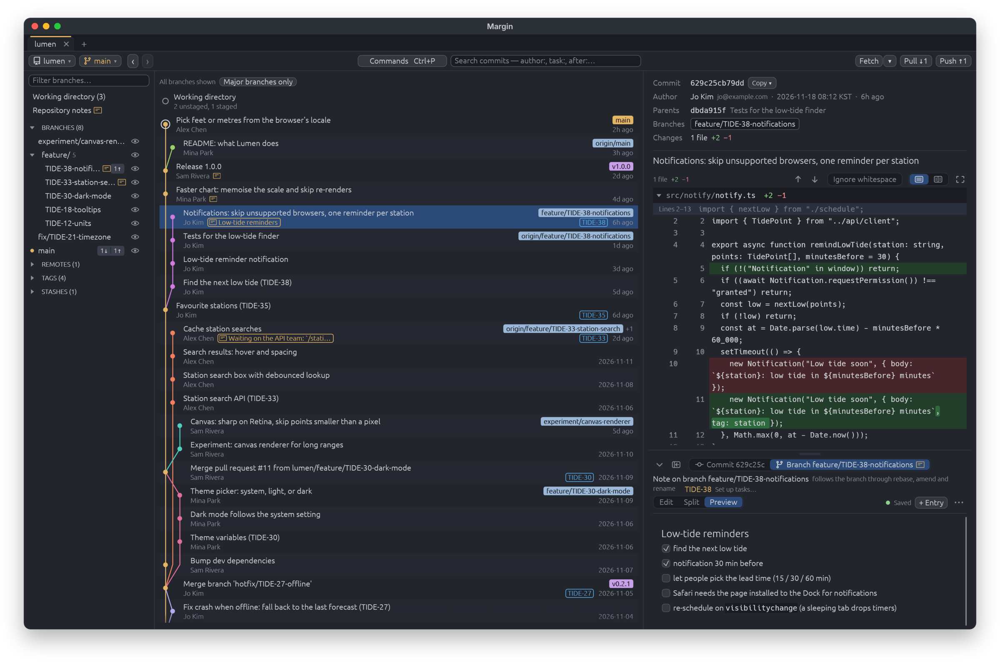

<p align="center"></p>

<h1 align="center">Margin</h1>

<p align="center">
A light, fast git client for macOS, Windows, and Linux, with notes in the margin.<br>
Write Markdown notes on commits, branches, and tasks, and let AI agents read and write them too.
</p>

<p align="center">
<a href="https://github.com/wiggleji/margin/releases/latest"><b>Download</b></a> (macOS · Windows · Linux) ·
<a href="docs/GUIDE.md">Guide</a>
</p>

<p align="center">
<a href="https://buymeacoffee.com/wiggleji"></a>
</p>





## Features

- **Git client:** history graph, diffs, staging, commit, branches, stash, worktrees, Git Flow, and a command palette (⌘P) for everything.
- **Notes:** Markdown notes on commits, branches, tasks, and the repo. Plain files in `.git/margin/notes`, never committed.
- **Code review:** compare any two branches like a pull request, or review a GitHub pull request in Margin: files changed with Viewed marks, commits, conversation, comments on any line, and Approve / Request changes.
- **GitHub:** pull request status, CI checks, and review threads right in the diff, with reply and resolve.
- **Tasks:** Jira, GitHub Issues, or any tracker by link.
- **Agents (MCP):** an MCP server so AI agents share your notes and see git, PRs, and tasks.
- **Notes sync** across your Macs through iCloud Drive, Dropbox, or Google Drive.
- **Light:** about 13 MB, near-zero CPU when idle, around 40 MB of memory.

## Install

Get the latest from [Releases](https://github.com/wiggleji/margin/releases/latest):

- **macOS** (Apple Silicon and Intel): **Margin-&lt;version&gt;.dmg**. Open it and drag Margin into Applications. After that, Margin updates itself (**Margin → Check for Updates…**; automatic by default). If macOS says the app can't be opened, run this once:

  ```bash
  xattr -dr com.apple.quarantine /Applications/Margin.app
  ```

- **Windows** (64-bit): **Margin-&lt;version&gt;-windows-x64-setup.exe** (no administrator rights needed; it can add `margin` to PATH), or the portable zip. Install [Git for Windows](https://git-scm.com/download/win) first. If SmartScreen says *Windows protected your PC*, click **More info → Run anyway** (the installer isn't code-signed yet).
- **Linux** (x64): **Margin-&lt;version&gt;-x86_64.AppImage** for any distribution (`chmod +x` it and run; it updates itself), **margin_&lt;version&gt;_amd64.deb** for Debian and Ubuntu (`sudo apt install ./margin_<version>_amd64.deb`), or **margin-&lt;version&gt;-linux-x64.tar.gz** for any distribution (unpack, then `./install.sh` installs to `~/.local`). Needs `git`, and `zenity` or `kdialog` for folder pickers.

### Open from the terminal

In Margin, choose **Margin → Install 'margin' Command…** (or ⌘P → *Install 'margin' command*). Then:

```bash
margin .
```

```bash
margin ~/src/my-project
```

If Margin is already open, the folder opens as a new tab in the same window.

## Connect an agent

Add Margin's MCP server to your agent's configuration:

```json
{
  "mcpServers": {
    "margin": {
      "command": "/Applications/Margin.app/Contents/MacOS/margin-mcp",
      "args": ["--repo", "/path/to/repo"]
    }
  }
}
```

Elsewhere, `command` is `margin-mcp` next to the app: on Windows `%LOCALAPPDATA%\Programs\Margin\margin-mcp.exe` (installer default), from the `.deb` `/usr/bin/margin-mcp`, from the tar.gz `~/.local/bin/margin-mcp`. With the AppImage, use the AppImage itself with `"args": ["mcp", "--repo", "/path/to/repo"]`.

## Build from source

Requires `git` and [rustup](https://rustup.rs) (the Rust version is pinned in `rust-toolchain.toml`).

```bash
cargo build --release
```

```bash
./target/release/margin /path/to/repo
```

Margin builds and runs on **macOS, Windows, and Linux** from the same source; CI tests all three.

- **Windows:** install [Git for Windows](https://git-scm.com/download/win) first; run `target\release\margin.exe`.
- **Linux:** install the X11/Wayland libraries first (`sudo apt-get install libxcb-render0-dev libxcb-shape0-dev libxcb-xfixes0-dev libxkbcommon-dev libssl-dev` on Debian/Ubuntu). For folder pickers, have `zenity` or `kdialog` installed.

To package a DMG or cut a release, see [docs/RELEASING.md](docs/RELEASING.md).

## Contributing

Issues and pull requests are welcome: see [CONTRIBUTING.md](CONTRIBUTING.md).

## Support

Margin is free and open source. If it helps you, you can [buy me a coffee](https://buymeacoffee.com/wiggleji). ☕

<a href="https://buymeacoffee.com/wiggleji"></a>

## License

MIT, see [LICENSE](LICENSE). Third-party notices: [THIRD_PARTY_NOTICES.md](THIRD_PARTY_NOTICES.md).
