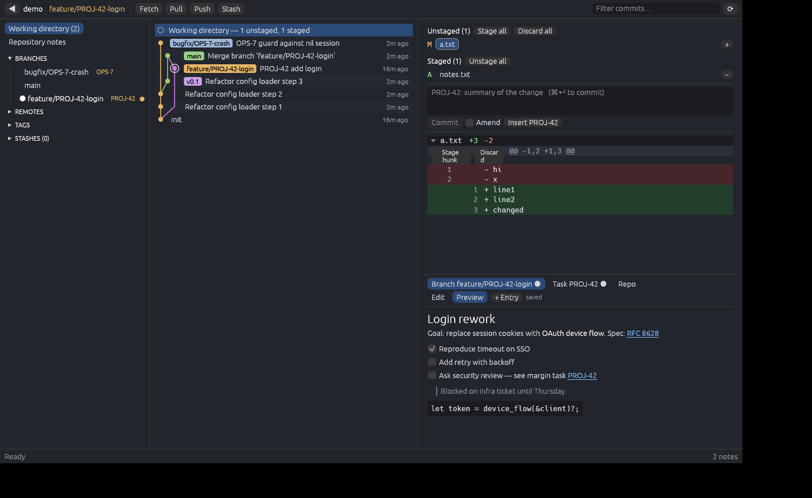

<p align="center"></p>

<h1 align="center">Margin</h1>

<p align="center">
A light, fast git client for macOS, with notes in the margin.<br>
Write Markdown notes on commits, branches, and tasks, and let AI agents read and write them too.
</p>

<p align="center">
<a href="https://github.com/wiggleji/margin/releases/latest"><b>Download for macOS</b></a> ·
<a href="docs/GUIDE.md">Guide</a> ·
<a href="https://buymeacoffee.com/wiggleji">Buy me a coffee</a>
</p>



## Features

- **Git client:** history graph, diffs, staging, commit, branches, stash, worktrees, Git Flow, and a command palette (⌘P) for everything.
- **Notes:** Markdown notes on commits, branches, tasks, and the repo. Plain files in `.git/margin/notes`, never committed.
- **GitHub:** pull request status, CI checks, and review threads right in the diff, with reply and resolve.
- **Tasks:** Jira, GitHub Issues, or any tracker by link.
- **Agents (MCP):** an MCP server so AI agents share your notes and see git, PRs, and tasks.
- **Notes sync** across your Macs through iCloud Drive, Dropbox, or Google Drive.
- **Light:** about 13 MB, near-zero CPU when idle, around 40 MB of memory.

## Install

Download **Margin-&lt;version&gt;.dmg** from [Releases](https://github.com/wiggleji/margin/releases/latest), open it, and drag Margin into Applications. It runs on Apple Silicon and Intel Macs.

If macOS says the app can't be opened, run this once:

```bash
xattr -dr com.apple.quarantine /Applications/Margin.app
```

## Connect an agent

Add Margin's MCP server to your agent's configuration:

```json
{
  "mcpServers": {
    "margin": {
      "command": "/Applications/Margin.app/Contents/MacOS/margin-mcp",
      "args": ["--repo", "/path/to/repo"]
    }
  }
}
```

## Build from source

Requires Rust 1.88+ and `git`.

```bash
cargo build --release
```

```bash
./target/release/margin /path/to/repo
```

To package a DMG or cut a release, see [docs/RELEASING.md](docs/RELEASING.md).

## Support

Margin is free and open source. If it helps you, you can [buy me a coffee](https://buymeacoffee.com/wiggleji). ☕

<a href="https://buymeacoffee.com/wiggleji"></a>

## License

MIT, see [LICENSE](LICENSE). Third-party notices: [THIRD_PARTY_NOTICES.md](THIRD_PARTY_NOTICES.md).
