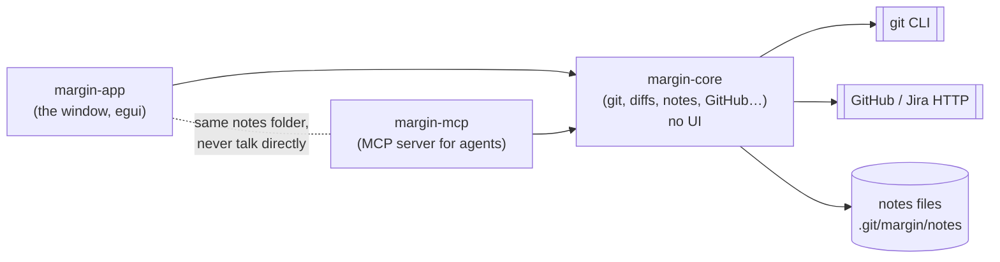
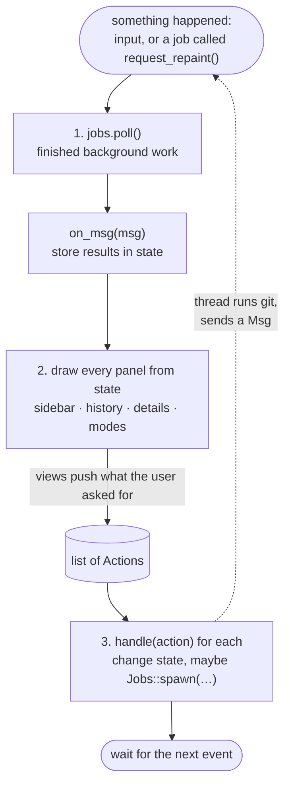
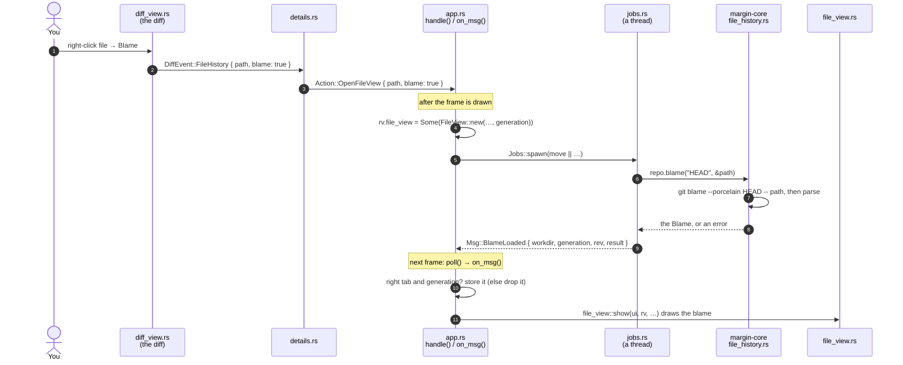

# Code tour

A guided walk through Margin's code for contributors: how a click turns into a git command and back into pixels, the rules the code keeps, and the steps to add a feature. Read [ARCHITECTURE.md](ARCHITECTURE.md) for *what* is where and *why*. This page is about *how* to change it.

You don't need to know egui, and only a little Rust. The patterns the code leans on are explained in [Rust you'll meet](#rust-youll-meet).

- [The big picture](#the-big-picture)
- [One frame](#one-frame)
- [One click, start to finish](#one-click-start-to-finish)
- [Rules of the codebase](#rules-of-the-codebase)
- [Adding a feature](#adding-a-feature)
- [Rust you'll meet](#rust-youll-meet)
- [Finding your way in the big files](#finding-your-way-in-the-big-files)
- [Build, test, check](#build-test-check)

## The big picture

Three crates. Dependencies point one way: the two programs use the core, and the core never knows a window exists.



Most features come as a pair with the same name: the logic in `margin-core/src/<feature>.rs` (plain functions and data, tested against a real temporary repository), and the screen in `margin-app/src/<feature>.rs`. For example, `core::file_history` reads `git log` and `git blame`; `app::file_view` draws them.

Inside the app, three pieces of state matter:

| Type | File | What it is |
|---|---|---|
| `MarginApp` | `app.rs` | The whole app: settings, open tabs, dialogs, the job runner. |
| `RepoView` | `app.rs` | One repository tab: its `Snapshot`, the selection, diffs, the notes editor, and whichever mode is open (review, conflicts, rebase, insights, file view). `MarginApp.rv` is the active tab; the others wait in `MarginApp.others`. |
| `Snapshot` | `jobs.rs` | What a refresh read from git: status, commits, refs, stashes, worktrees. Replaced as a whole, never patched. |

## One frame

egui is *immediate mode*: there are no widget objects that live between frames. Every frame (after a click, a key press, or when a background job finishes), `MarginApp::ui` runs from top to bottom and draws the whole window again from Margin's own state. Nothing runs when nothing happens, which is why Margin idles at near-zero CPU.



The important split: **drawing never changes app state directly.** A view gets the parts of state it shows (usually `&mut RepoView`) plus a `&mut Vec<Action>`, and when the user clicks something it pushes an `Action`. After drawing, `handle()` runs each action with full access to `MarginApp`. This keeps borrowing simple (while drawing, the views hold borrows of the state, so they couldn't call `&mut self` methods anyway), and it means every user intent goes through one `match`, where it's easy to find.

## One click, start to finish

Here is what happens when you right-click a file in a diff and choose **Blame**. Every feature follows the same path, so once this one is clear, the rest of the app reads the same way.



The same steps in the code:

1. **The view reports, it doesn't act.** The diff widget is shared by several screens, so it returns `DiffEvent`s (`diff_view.rs`) and lets each screen decide what they mean. `details.rs` and `review.rs` turn `DiffEvent::FileHistory` into `Action::OpenFileView`.
2. **`handle()` changes state and starts the work.** In `app.rs`, `OpenFileView` closes other modes, creates the `FileView` with a new generation number, and spawns two jobs: the file's history and its blame.
3. **The job runs git off the UI thread.** `Jobs::spawn` starts a thread that runs the closure, sends the `Msg` back over a channel, and asks egui to repaint.
4. **`on_msg()` checks that the answer is still wanted.** It drops the result if you've switched tabs (`workdir` differs) or reopened the view since (`generation` differs). Otherwise it stores it.
5. **The next frame draws it.** The central panel sees `rv.file_view` is open and calls `file_view::show` instead of the history.

Opening a mode **in place of the history** (review, conflicts, rebase, insights, file view) always works like this: an `Option<…>` field on `RepoView`, a flag in the central-panel code in `MarginApp::ui` (`let filing = rv.file_view.is_some();`), and a `show()` in the mode's module that draws a header with **‹ History** (which pushes the mode's `Close…` action).

## Rules of the codebase

| Rule | Why | How it looks |
|---|---|---|
| **Never call git or the network on the UI thread.** | `git status` in a monorepo can take seconds, and the window would freeze. | `self.jobs.spawn(move \|\| Msg::…)`; git-changing operations go through `op()`, which also shows Busy and refreshes afterwards. |
| **Drop stale answers.** | Jobs finish in any order. A slow answer for a tab, commit or view you've left must not overwrite the current one. | Every repo `Msg` carries `workdir`; views that reload carry a `generation` that's bumped on each load. Compare both before storing. |
| **The core has no UI.** | It's shared with `margin-mcp`, and it's testable without a window. | `margin-core` never depends on egui. Return data (`Vec<FileCommit>`, `Blame`), not strings to display. |
| **Use the git CLI, not a git library.** | Hooks, signing, credential helpers, LFS and SSO all keep working because it's the user's own git. | `repo.run(&["log", …])`, with machine-readable output: `--porcelain`, `-z`, `--format=%x1f…` separators. |
| **Check revisions before passing them to git.** | A "revision" starting with `-` would be read as an option. | `check_rev(rev)?` in the core, then `--` before paths. |
| **Same source for macOS, Windows and Linux.** | One codebase; CI builds and tests all three. | OS differences live in `core::platform` and `app::platform`, never scattered `cfg!` checks in features. |
| **Errors are text for the user.** | Almost every error ends up in the status line. | `margin_core::Result<T>` with `Error(String)`; across the job boundary use `Result<T, String>` (`.map_err(\|e\| e.0)`) and show it with `self.err(e)`. |

## Adding a feature

A checklist, using **file history and blame** as the worked example. Open those files side by side as you read.

**1. The logic, in `margin-core`** (`crates/margin-core/src/file_history.rs`)

- Plain data types (`FileCommit`, `Blame`) and methods on `Repo` that run git and parse its output (`file_history`, `file_change_in`, `blame`).
- Keep parsing in its own function (`parse_blame(&str)`) so tests can feed it text directly.
- Register the module in `lib.rs` (`pub mod file_history;`).
- **Tests:** one for the parser with handwritten git output, and one against a real temporary repository: create it in `std::env::temp_dir()`, run `git init` and `git commit` with `-c init.defaultBranch=main -c commit.gpgsign=false`, set `user.name`/`user.email` and `core.autocrlf false` (CI machines have no identity, and Windows rewrites line endings), then call your functions.

**2. The messages, in `margin-app`**

- `app.rs`, `enum Action`: what the user can ask for (`OpenFileView`, `CloseFileView`, `FileViewSelect(usize)`, `FileViewBlameAt { … }`).
- `jobs.rs`, `enum Msg`: what comes back from threads (`FileHistoryLoaded`, `FileCommitDiff`, `BlameLoaded`), each with `workdir` and `generation`. Add new variants to `Msg::workdir()` too, so answers for background tabs are routed correctly.

**3. The state**

- A field on `RepoView` (`pub file_view: Option<FileView>`) plus its generation counter, initialised in `RepoView::new`.

**4. The behaviour**

- `handle()`: one arm per `Action`. Change state, then `self.jobs.spawn(…)`.
- `on_msg()`: one arm per `Msg`. Find the target (a helper like `file_view_for(workdir, generation)` returns `None` for stale answers) and store the result.

**5. The screen** (`crates/margin-app/src/file_view.rs`)

- A `show(ui, rv, …, actions)` function that draws from state and pushes `Action`s.
- Show the three states of anything loaded: loading (`None` → a spinner), failed (`Some(Err)` → the error), loaded (`Some(Ok)`).
- Reuse what exists: `DiffView` for diffs, `review::entry_block` for selectable list rows, `widgets::segmented` for tabs, `theme::…()` for colours (never hard-coded colours: there are twelve themes), `syntax` for code colouring.
- Register the module in `main.rs` (`mod file_view;`) and host it in the central panel in `MarginApp::ui`.

**6. The ways in**

- Context menus: `diff_view.rs` (file rows) emitting a `DiffEvent`, mapped in `details.rs` and `review.rs`.
- The command palette: `commands.rs`. A command is a title, a hint, search keywords, input steps (`pick`, `input`, `confirm`) and a closure that returns actions.
- The macOS menu bar: `menu_bar.rs`, which runs palette commands by name (`Cmd::Palette("Repository/File history…")`).

**7. The docs**

- `docs/GUIDE.md`: what the feature does and how to open it, in plain words.
- `docs/ARCHITECTURE.md`: a row in the feature table, and in *Key decisions* if there's a choice worth explaining.
- The README's feature list, if it's a headline feature.

**8. Check it** (see [Build, test, check](#build-test-check)), then try it in the app on a real repository. `scripts/demo-repo.sh` builds one with several authors, merges, tags, stashes and notes.

## Rust you'll meet

Just the patterns this codebase uses over and over. For Rust itself, [the Rust book](https://doc.rust-lang.org/book/) is the best start; chapters 4 (ownership), 6 (enums and `match`), 9 (errors) and 16 (threads) cover nearly everything here.

**Enums with data, and `match`.** `Action` and `Msg` are enums whose variants carry data. `match` must handle every variant, so when you add one, the compiler shows every place that needs updating.

```rust
match a {
    OpenFileView { path, blame } => { /* … */ }
    CloseFileView => { rv.file_view = None; }
    // …
}
```

**Loading, failed, loaded: `Option<Result<T, String>>`.** `None` means still loading; `Some(Err(e))` failed; `Some(Ok(v))` loaded.

```rust
match &f.commits {
    None => { ui.spinner(); }
    Some(Err(e)) => { ui.colored_label(theme::ERROR(), e); }
    Some(Ok(commits)) => { /* draw them */ }
}
```

**`let … else` for early exits.** Read it as "this must match, otherwise return". It keeps the happy path unindented.

```rust
let Some(rv) = &mut self.rv else { return };      // no repository open
let Some(f) = &mut rv.file_view else { return };  // the view was closed
```

**Moving data into a thread.** A thread may outlive the function that started it, so its closure can't borrow anything. It must *own* what it uses. Clone what it needs first (`Repo` is two paths, so cloning is cheap), then `move` it in:

```rust
let (repo, generation) = (rv.repo.clone(), f.generation);
self.jobs.spawn(move || Msg::BlameLoaded {
    workdir: repo.workdir.clone(),
    generation,
    rev: rev.clone(),
    result: repo.blame(&rev, &path).map_err(|e| e.0),
});
```

**`?` for errors.** In a function returning `Result`, `expr?` returns the error early or unwraps the value. The core uses it everywhere: `let out = self.run(&[…])?;`.

**Borrowing around egui closures.** egui lays out with closures (`ui.horizontal(|ui| { … })`). The closure borrows whatever it uses, so you can't also use those things mutably outside it at the same moment. When the compiler complains:

- compute values *before* the closure (`let label = f.path.clone();`), or
- record what happened in a local (`let mut pick = None;` … `pick = Some(i);`) and act on it *after* the closure ends.

`file_view.rs` does the second one for clicks in a list.

## Finding your way in the big files

`app.rs` is large because it's the hub every feature passes through. Search for these names rather than scrolling:

| Look for | What's there |
|---|---|
| `pub enum Action` | Everything the user can ask for, with a comment on each. |
| `pub struct RepoView` / `fn new(repo` | A tab's state, and its initial values. |
| `pub fn refresh` | Loading a `Snapshot` (status, refs and the log in parallel). |
| `fn op(` | Running a git operation that changes the repository. |
| `pub fn handle(` | The big `match` over `Action`. |
| `fn on_msg(` | The big `match` over `Msg`. |
| `fn background_msg(` | Answers for tabs that aren't active. |
| `fn ui(&mut self` | The frame: poll jobs, toolbar, panels, palette, then run the actions. |
| `let reviewing =` | Where the history is swapped for a mode (review, conflicts, rebase, insights, file view). |

Other places worth knowing:

| File | What's there |
|---|---|
| `jobs.rs` | `Snapshot`, `enum Msg`, and `Jobs` (spawn and poll). |
| `diff_view.rs` | The diff widget used everywhere: layout, find, hunks, comments, context menus, `DiffEvent`. |
| `commands.rs` | Every command palette entry. |
| `theme.rs` | Palettes and colour functions (`theme::ACCENT()`, `theme::TEXT_DIM()`, …). |
| `widgets.rs` | Shared controls: segmented tabs, icon buttons, chips. |
| `core/src/git.rs` | `Repo`, `run()`, and most git reads and writes. |
| `margin-mcp/src/main.rs` | The MCP server: the tool list and each tool's handler. |

## Build, test, check

```bash
cargo run -p margin-app -- /path/to/a/repo
```

```bash
cargo test --workspace
```

```bash
cargo clippy --workspace --all-targets
```

CI (`.github/workflows/ci.yml`) builds and runs the tests on **Linux, Windows and macOS** for every pull request, and packages an unsigned macOS app. A change that only compiles on your OS shows up there. To catch it before you push, you can type-check another target locally:

```bash
rustup target add x86_64-pc-windows-gnu
```

```bash
cargo check -p margin-app --target x86_64-pc-windows-gnu
```

Things that commonly break on one OS only:

- **Paths:** use `Path`/`PathBuf` and `join`, never `"/"`, except for git's own paths, which always use `/`.
- **Line endings:** Windows checkouts may rewrite them; tests that compare file contents set `core.autocrlf false`.
- **Child processes:** start git through `Repo` (`base_cmd`), which hides the console window on Windows and sets the environment git needs.

Then try the change in the app. For a UI change, add a screenshot to the pull request. How to branch, name and open it is in [CONTRIBUTING.md](../CONTRIBUTING.md), and how releases are made is in [RELEASING.md](RELEASING.md).
